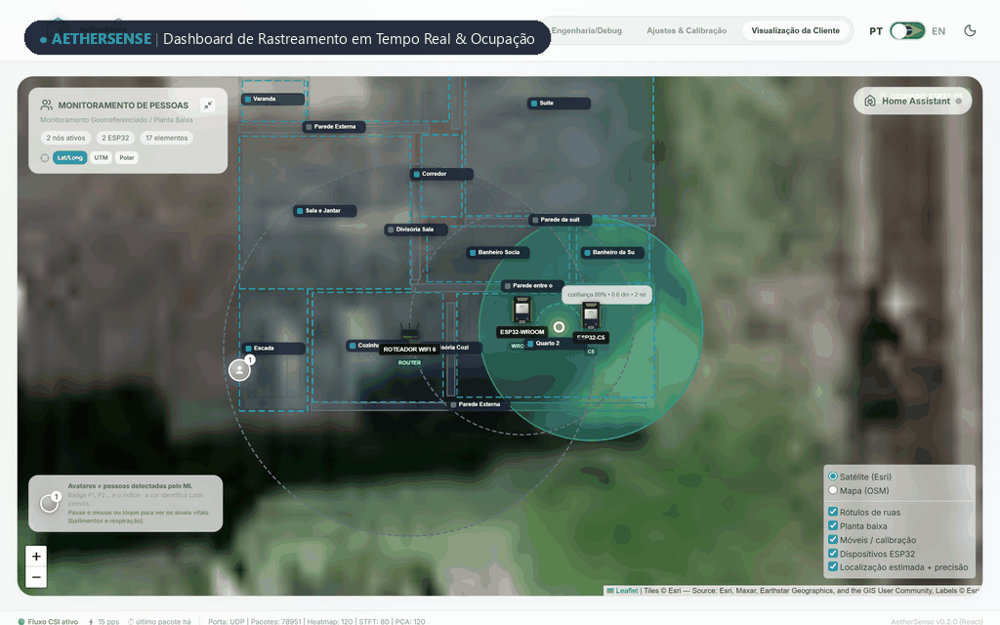
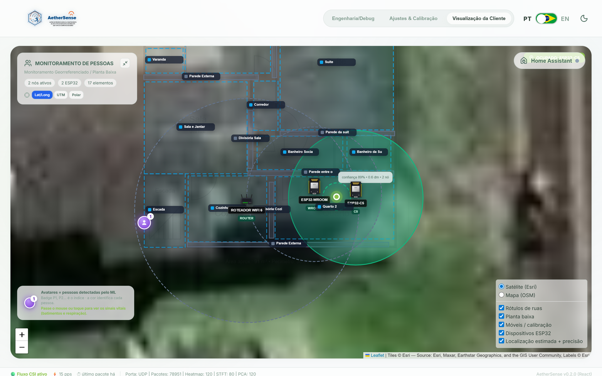
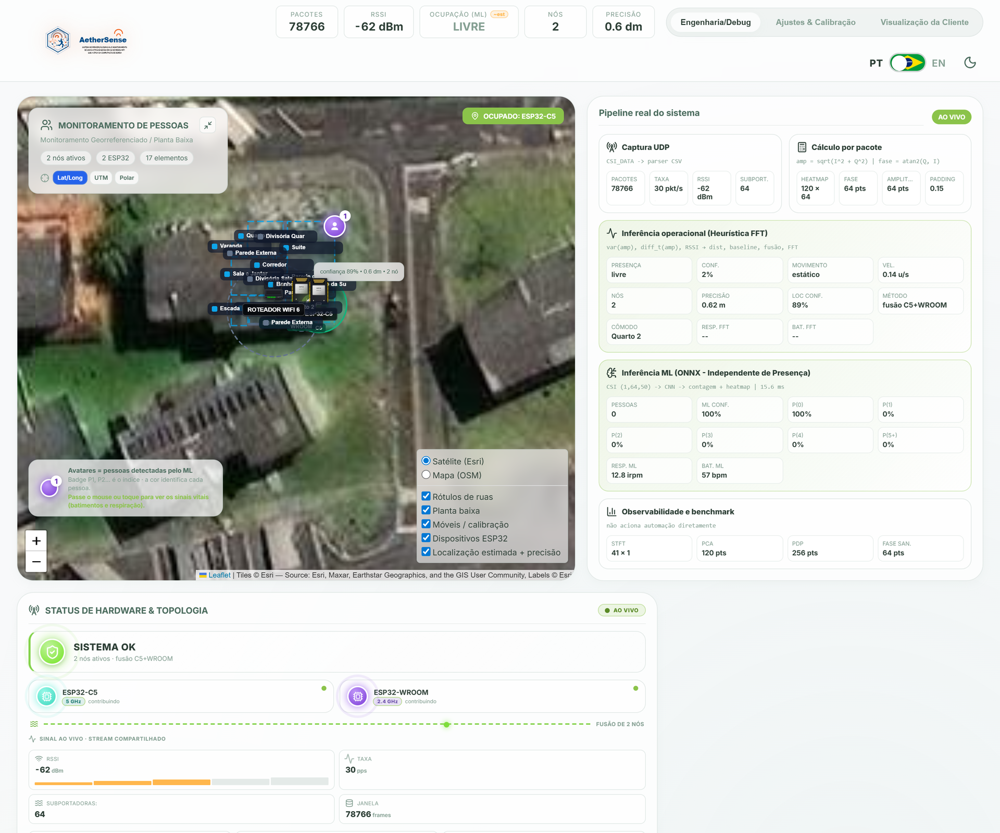
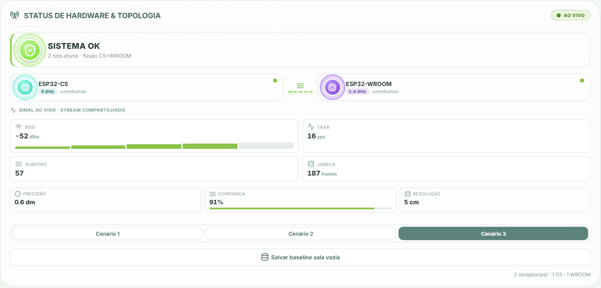
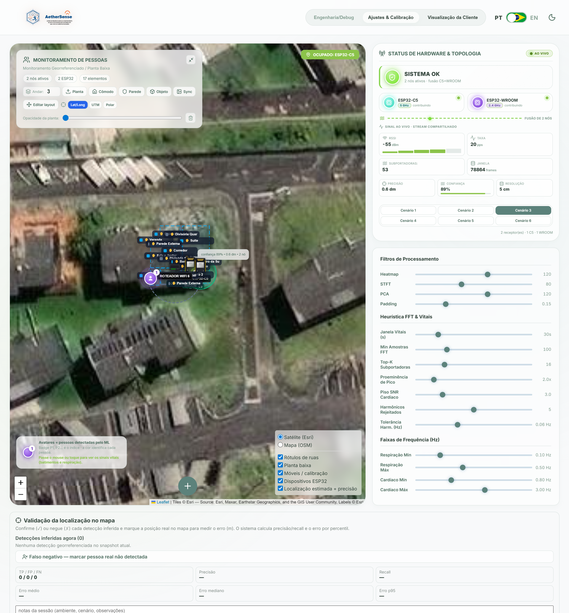
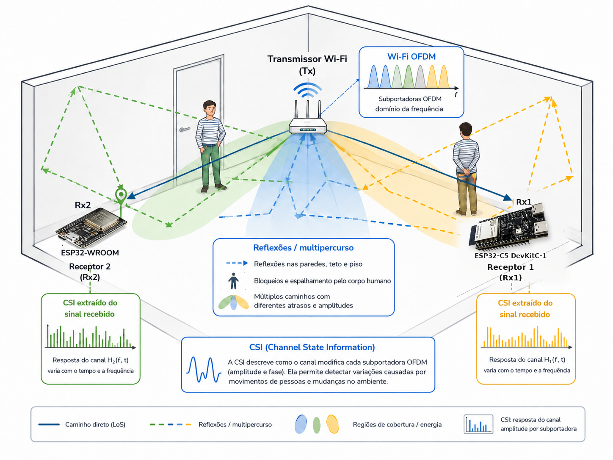

<p align="center">
  
</p>

<p align="center">
  <a href="README.md">English (USD $)</a> ·
  <a href="README.pt-BR.md">Português (BR · BRL R$)</a> ·
  <a href="README.es.md">Español (EUR € / USD $)</a> ·
  <strong>Deutsch (EUR €)</strong>
</p>

# AetherSense

**AetherSense** ist eine Open-Source-Plattform für kamerafreie räumliche Präsenzerkennung und lokale Smart-Home-Automatisierung auf Basis von **Wi-Fi Channel State Information (CSI)**. Mit günstigen ESP32-Knoten, einem effizienten Rust-Server, Web-Dashboard, optionaler ONNX-Inferenz und Home-Assistant-Integration ermöglicht das System **geolokalisierte Raumerkennung, Bewegungsanalyse, experimentelle Vitaltrend-Schätzung sowie lokale IR-/Relais-Steuerung** über das vorhandene WLAN.

> **Wissenschaftliche Transparenz:** AetherSense entstand als akademische Abschlussarbeit (*TCC*) für lokale, kamerafreie räumliche Präsenzerkennung und Smart-Home-Automatisierung. Positions- und Vitalwertschätzungen sind experimentell und dürfen nicht für medizinische Diagnosen, Sicherheits- oder lebenskritische Anwendungen verwendet werden.

<p align="center">
  
</p>

---

## Warum AetherSense? Kosten- & Effizienzvergleich (`EUR €`)

> Richtpreise auf **Amazon.de** und **AliExpress** (zzgl. eventueller Versand- oder Einfuhrkosten). DIY-BOM-Preise beziehen sich auf reine Elektronikkomponenten ohne Gehäuse, Montage und Support.

| Lösung | Technologie | Geschätzter Preis (EUR) | Statische Präsenz (Sitzen/Schlafen) | Mehrraum / Durch Wände | Integriertes IR / Relais | Kamerafreie Privatsphäre | 100 % Lokal (Ohne Cloud) | Links & Bezugsquellen |
| :--- | :--- | :---: | :---: | :---: | :---: | :---: | :---: | :--- |
| **AetherSense (1-Knoten Wi-Fi CSI)** *(DIY BOM)* | Wi-Fi CSI (`ESP32-WROOM-32` / `ESP32-C5`) | **€5–€15** | Ja (CSCR + Baseline) | Teilweise (1 Raum/Link) | Ja (38 kHz IR + Relais) | Ja | Ja | [Espressif ESP32-C5](https://www.espressif.com/en/products/socs/esp32-c5) · [AliExpress ESP32](https://www.aliexpress.com/w/wholesale-esp32-wroom-32.html) |
| **AetherSense (Multi-Knoten-Kit)** *(DIY BOM)* | Dual-Band Wi-Fi CSI (`C5` 5 GHz + `WROOM` 2,4 GHz) | **€18–€28** | Ja | **Ja** (Zonenfusion) | Ja (pro Knoten) | Ja | Ja | [Releases](https://github.com/joaosnet/aethersense/releases) · [AliExpress C5](https://www.aliexpress.com/w/wholesale-esp32-c5.html) |
| **RuView (WiFi DensePose)** | Wi-Fi CSI (`3–6× ESP32-S3` Mesh) | **~€50+** | Ja | Ja (Mesh) | Nein | Ja | Ja | [GitHub (ruvnet/RuView)](https://github.com/ruvnet/RuView) · [AliExpress ESP32-S3](https://www.aliexpress.com/w/wholesale-esp32-s3.html) |
| **Tuya mmWave Präsenzmelder (`ZY-M100`)** | 5,8 / 24 GHz mmWave-Radar | **€20–€65** | **Ja** | Nein (Sichtlinie / 1 Raum) | Nein | Ja | Zigbee: Ja · Wi-Fi: Tuya-Cloud | [Blakadder](https://blakadder.com/) · [Zigbee2MQTT](https://www.zigbee2mqtt.io/) · [AliExpress](https://www.aliexpress.com/w/wholesale-tuya-zy-m100-mmwave.html) |
| **Aqara Presence Sensor FP2** | 60 GHz mmWave Multi-Zonen-Radar | **€70–€85** | **Ja** (bis 30 Zonen / 5 Personen) | Nein (1 Gerät pro Raum) | Nein | Ja | Ja (HomeKit / HA) | [Aqara Offiziell](https://www.aqara.com/en/product/presence-sensor-fp2/) · [Amazon DE](https://www.amazon.de/s?k=Aqara+FP2) |
| **Standard Wi-Fi PIR-Bewegungsmelder** | Passiv-Infrarot (PIR) | **€4–€20** | **Nein** (nur Grobbewegung) | Nein (freies Sichtfeld) | Nein | Ja | Meist Cloud | [Amazon DE](https://www.amazon.de/s?k=wifi+pir+bewegungsmelder) |
| **Wi-Fi IP-Kamera (`Tapo C200`)** | Optisches Video + KI | **€20–€30** | Ja (Video) | Nein (Licht/Sichtlinie) | Nein | **Nein** (Video/Audio) | Teilweise (RTSP / SD) | [TP-Link Offiziell](https://www.tp-link.com/en/home-networking/cloud-camera/tapo-c200/) · [Amazon DE](https://www.amazon.de/s?k=TP-Link+Tapo+C200) |

> Ein einzelner Knoten deckt Raum-/Zonenpräsenz und Bewegung ab; Dual-Band-Multi-Knoten-Kits verbessern die raumübergreifende Zonenfusion und Positionsverfolgung.

---

## Kaufen oder Selbst Bauen (`EUR €`)

### Option A — Vorkonfiguriertes Plug-and-Play-Kit *(Demnächst)*
- **AetherSense Plug-and-Play-Kit**: *Vorgeflashte Kits mit Schutzgehäuse, 5-V-Netzteil und geführter lokaler Einrichtung — in Vorbereitung.* Updates unter [GitHub Releases](https://github.com/joaosnet/aethersense/releases) und [Discussions](https://github.com/joaosnet/aethersense/discussions).

### Option B — DIY-Stückliste (Selbstbau)
- **Primärer 5-GHz-Wi-Fi-6-Knoten (`ESP32-C5-DevKitC-1`)**: ~**€14–€18** — [Espressif](https://www.espressif.com/en/products/socs/esp32-c5) · [AliExpress](https://www.aliexpress.com/w/wholesale-esp32-c5-devkit.html)
- **Sekundärer 2,4-GHz-Knoten (`ESP32-WROOM-32`)**: ~**€3–€8** (AliExpress) / **€6–€12** (Amazon DE) — [AliExpress](https://www.aliexpress.com/w/wholesale-esp32-wroom-32.html) · [Amazon DE](https://www.amazon.de/s?k=ESP32-WROOM-32)
- **Optionales 38-kHz-IR-TX/RX-Modul**: ~**€1–€3** — [AliExpress](https://www.aliexpress.com/w/wholesale-ir-transmitter-receiver-38khz-esp32.html)
- **USB-C 5 V ≥ 1 A Netzteil**: ~**€3–€5**

---

## System-Showcase

### 1. Operatives Echtzeit-Dashboard
Interaktiver Grundriss mit Echtzeit-Positionsschätzung, Präsenz-Heatmap, Belegungszählung und konfigurierbaren Automatisierungszonen:

<p align="center">
  
</p>

- **Räumliches Tracking**: kontinuierliche Schätzung mit EWMA-Glättung und Multi-Knoten-Zonenfusion;
- **Smart-Home-Integration**: lokale Auslöser und automatische Home-Assistant-Einbindung via MQTT Discovery;
- **Integrierte Aktoren**: IR-Lern-/Sendefunktion (Klimaanlage/TV) und Relaissteuerung pro Knoten.

### 2. Digitale Signalverarbeitung (DSP) & HF-Diagnose
Die Entwickleransicht (*Dashboard Debug*) zeigt die physikalische Signalpipeline in Echtzeit:

<p align="center">
  
</p>

- **Subträger-Amplituden-Heatmap** · **Doppler-STFT-Spektrogramm** · **Phasenbereinigung** · **Power Delay Profile (PDP) via IFFT**.

### 3. Hardware-Topologie & Leerraum-Kalibrierung
Live-Telemetrie (Abtastrate, RSSI, Frequenzband, Latenz) sowie statische Hintergrundkalibrierung ohne lokale Trainingsdaten von Personen:

<p align="center">
  
</p>

<p align="center">
  
</p>

### 4. Physikalische Grundlagen (OFDM & CSI)
Passives Wi-Fi-Sensing nutzt IEEE 802.11 OFDM-Subträger zur Erkennung feiner Mehrwege-Störungen ohne Kamera:

<p align="center">
  
</p>

---

## Komponenten

| Verzeichnis | Inhalt |
| :--- | :--- |
| `firmware-rust/` | Aktive Firmware für ESP32-WROOM-32, ESP32-C5 und ESP32-C6 |
| `aethersense-server/` | Rust-Server: API, UDP-Ingest, CSI-DSP, ONNX-Inferenz und MQTT |
| `frontend/` | React + TypeScript Web-Dashboard |
| `ml/` | Training (nur öffentliche Datensätze), Evaluation und ONNX-Export |
| `homeassistant/` | Home-Assistant-Paket und Add-on |
| `esp_realtime_plot/` | Python-Tools für serielle Live-Inspektion |
| `docs/` | Architektur- und Integrationsdokumentation |

---

## Schnellstart

Repository klonen und lokale Konfiguration anlegen:

```bash
git clone https://github.com/joaosnet/aethersense.git
cd aethersense
cp aethersense-server/aethersense_config.example.json aethersense-server/aethersense_config.json
```

Dienste starten (Zugangsdaten ausschließlich per Umgebungsvariablen übergeben):

```bash
export AETHERSENSE_API_TOKEN="sicheres-token-waehlen"
export AETHERSENSE_MQTT_USERNAME="benutzer"
export AETHERSENSE_MQTT_PASSWORD="passwort"
docker compose up --build
```

- Dashboard: <http://localhost>
- API-Healthcheck: <http://localhost:8000/api/health>
- CSI-UDP-Eingang: `5005/udp` · Broker-Discovery: `5151/udp`

### Firmware Flashen (Entwickler-Workflow)
```bash
cd firmware-rust
uv run build.py build
uv run build.py flash --port DEIN_PORT
```
Siehe [firmware-rust/FLASHING.md](firmware-rust/FLASHING.md) für Hardware-Profile, Captive-Portal-Setup und Wiederherstellung.

---

## Dokumentation, Datenschutz & Sicherheit

- [Dokumentationsübersicht](docs/README.md) · [Architektur](docs/arquitetura-firmware-servidor.md) · [Home Assistant](docs/home-assistant-integration.md)
- [Backend](aethersense-server/README.md) · [Frontend](frontend/README.md) · [ML-Pipeline](ml/README.md)
- [Sicherheitsrichtlinie](SECURITY.md)

Das öffentliche Repository enthält keine Zugangsdaten, privaten Adressen, Geräte-IDs oder Rohmitschnitte. Sicherheitslücken bitte verantwortungsvoll über [SECURITY.md](SECURITY.md) melden.
