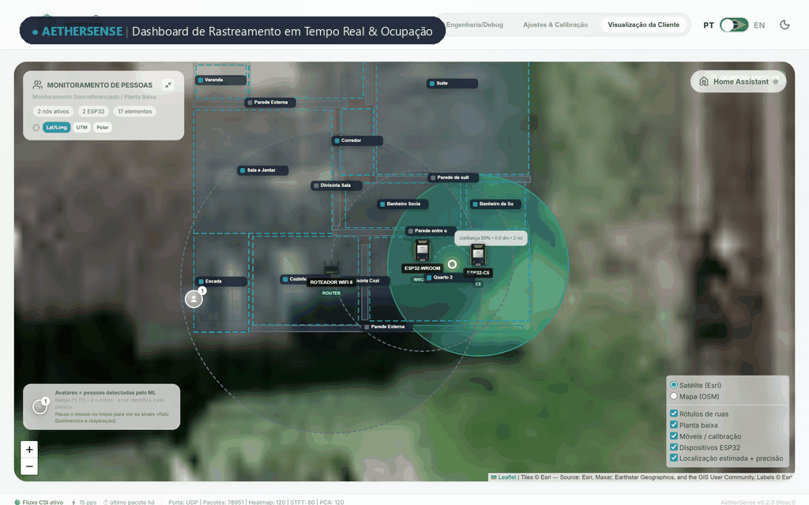
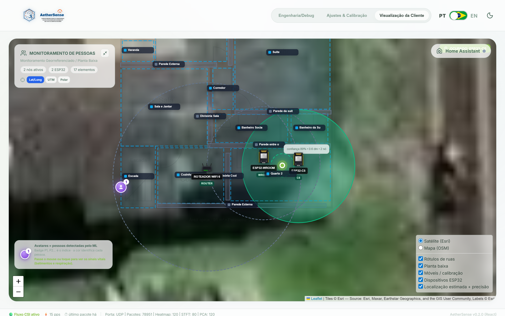
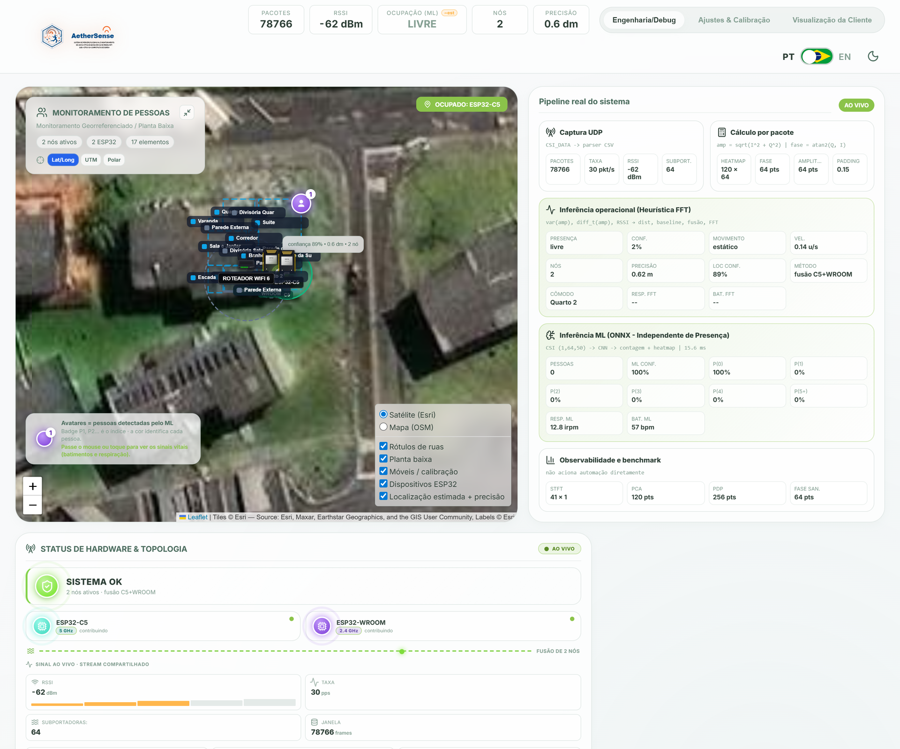
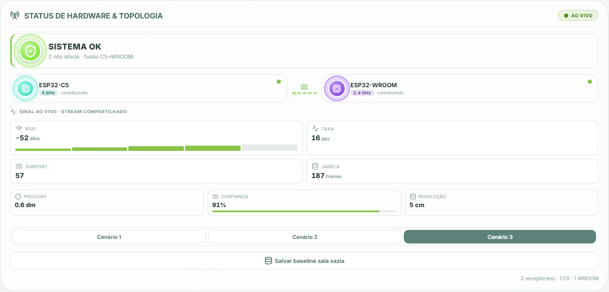
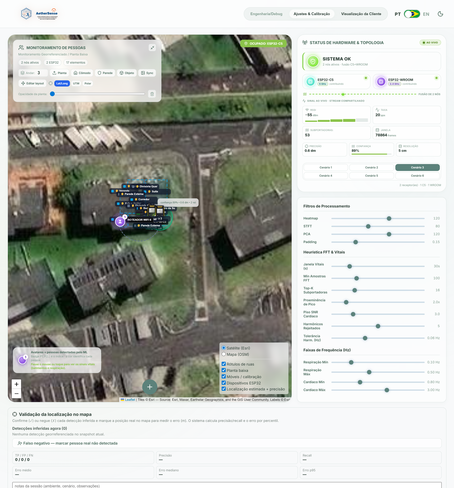
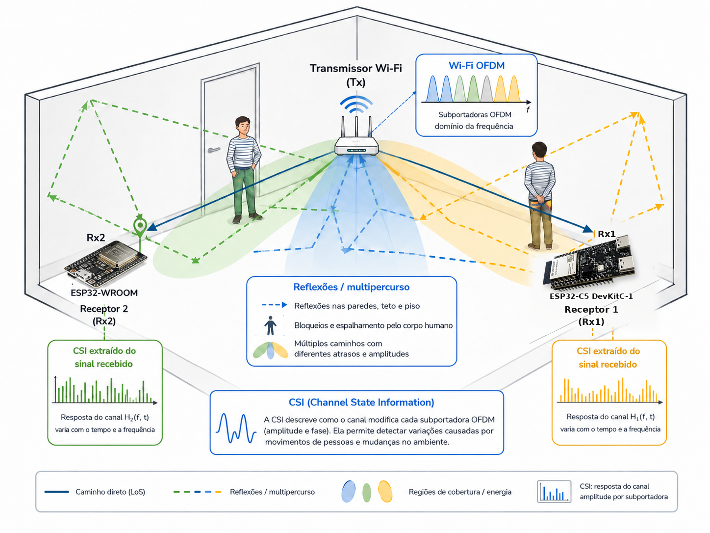

<p align="center">
  
</p>

<p align="center">
  <a href="README.md">English (USD $)</a> ·
  <a href="README.pt-BR.md">Português (BR · BRL R$)</a> ·
  <strong>Español (EUR € / USD $)</strong> ·
  <a href="README.de.md">Deutsch (EUR €)</a>
</p>

# AetherSense

**AetherSense** es una plataforma de código abierto de detección espacial y automatización del hogar basada en **Wi-Fi Channel State Information (CSI)** — **sin cámaras y 100 % local**. Combina nodos ESP32 de bajo coste, un servidor de alto rendimiento en Rust, un panel web, inferencia ONNX opcional e integración con Home Assistant para ofrecer **presencia geolocalizada por habitación/zona, seguimiento de movimiento, tendencias experimentales de signos vitales y control local por infrarrojos (IR) y relés** aprovechando tu red Wi-Fi actual.

> **Transparencia Científica:** AetherSense nació como proyecto de trabajo de fin de grado (*TCC*) para detección espacial y automatización local sin cámaras. Las estimaciones de ubicación y signos vitales son experimentales y no deben usarse para diagnóstico médico, seguridad crítica ni decisiones de riesgo vital.

<p align="center">
  
</p>

---

## ¿Por qué AetherSense? Comparativa de Coste y Eficiencia (`EUR €` / `USD $`)

> Precios orientativos en **Amazon España**, **Amazon EE. UU.** y **AliExpress** (sujetos a envío e impuestos locales como IVA/aranceles). Los valores DIY de AetherSense corresponden al coste de los componentes electrónicos antes de carcasa, montaje y garantía.

| Solución | Tecnología | Precio Est. (EUR / USD) | Presencia Estática (Sentado/Durmiendo) | Multihabitación / Atraviesa Paredes | Control IR / Relé Integrado | Privacidad (Sin Cámara) | 100 % Local (Sin Nube) | Enlaces de Referencia y Compra |
| :--- | :--- | :---: | :---: | :---: | :---: | :---: | :---: | :--- |
| **AetherSense (1 Nodo Wi-Fi CSI)** *(BOM DIY)* | Wi-Fi CSI (`ESP32-WROOM-32` / `ESP32-C5`) | **€5–€15** / **$5–$16** | Sí (CSCR + baseline) | Parcial (1 zona/enlace) | Sí (IR 38 kHz + Relé) | Sí | Sí | [Espressif ESP32-C5](https://www.espressif.com/en/products/socs/esp32-c5) · [AliExpress ESP32](https://www.aliexpress.com/w/wholesale-esp32-wroom-32.html) |
| **AetherSense (Kit Multi-Nodo)** *(BOM DIY)* | Wi-Fi CSI Dual-Band (`C5` 5 GHz + `WROOM` 2,4 GHz) | **€18–€28** / **$20–$30** | Sí | **Sí** (fusión por zonas) | Sí (por nodo) | Sí | Sí | [Releases](https://github.com/joaosnet/aethersense/releases) · [AliExpress C5](https://www.aliexpress.com/w/wholesale-esp32-c5.html) |
| **RuView (WiFi DensePose)** | Wi-Fi CSI (`3–6× ESP32-S3` Mesh) | **~€50+** / **~$54+** | Sí | Sí (mesh) | No | Sí | Sí | [GitHub (ruvnet/RuView)](https://github.com/ruvnet/RuView) · [AliExpress ESP32-S3](https://www.aliexpress.com/w/wholesale-esp32-s3.html) |
| **Sensor Presencia Tuya mmWave (`ZY-M100`)** | Radar mmWave 5,8 / 24 GHz | **€20–€65** / **$18–$40** | **Sí** | No (línea de vista / 1 sala) | No | Sí | Zigbee: Sí · Wi-Fi: Nube Tuya | [Blakadder](https://blakadder.com/) · [Zigbee2MQTT](https://www.zigbee2mqtt.io/) · [AliExpress](https://www.aliexpress.com/w/wholesale-tuya-zy-m100-mmwave.html) |
| **Aqara Presence Sensor FP2** | Radar mmWave 60 GHz Multizona | **€70–€85** / **$60–$83** | **Sí** (hasta 30 zonas / 5 personas) | No (1 unidad por sala) | No | Sí | Sí (HomeKit / HA) | [Aqara Oficial](https://www.aqara.com/en/product/presence-sensor-fp2/) · [Amazon ES](https://www.amazon.es/s?k=Aqara+FP2) · [Amazon US](https://www.amazon.com/s?k=Aqara+FP2) |
| **Sensor Movimiento PIR Wi-Fi Común** | Infrarrojo Pasivo (PIR) | **€4–€20** / **$4–$16** | **No** (solo movimiento) | No (cono óptico libre) | No | Sí | Normalmente Nube | [Amazon ES](https://www.amazon.es/s?k=sensor+movimiento+wifi+pir) |
| **Cámara IP Wi-Fi (`Tapo C200`)** | Vídeo Óptico + IA | **€20–€30** / **$25–$35** | Sí (visión) | No (necesita luz/visión) | No | **No** (vídeo/audio) | Parcial (RTSP / SD) | [TP-Link Oficial](https://www.tp-link.com/en/home-networking/cloud-camera/tapo-c200/) · [Amazon ES](https://www.amazon.es/s?k=TP-Link+Tapo+C200) |

> Los despliegues con 1 nodo cubren presencia por habitación/zona y movimiento; los kits multinodo de doble banda mejoran la fusión entre estancias y el seguimiento espacial.

---

## Dónde Comprar o Montar (`EUR €` / `USD $`)

### Opción A — Kit AetherSense Listo para Usar *(Próximamente)*
- **Kit Plug-and-Play AetherSense**: *Kits pregrabados con carcasa protectora, fuente de 5 V y configuración local guiada — en preparación.* Sigue las novedades en [GitHub Releases](https://github.com/joaosnet/aethersense/releases) y [Discussions](https://github.com/joaosnet/aethersense/discussions).

### Opción B — Lista de Materiales DIY (Móntalo Tú Mismo)
- **Nodo Principal 5 GHz Wi-Fi 6 (`ESP32-C5-DevKitC-1`)**: ~**€14–€18** / **~$15 USD** — [Espressif](https://www.espressif.com/en/products/socs/esp32-c5) · [AliExpress](https://www.aliexpress.com/w/wholesale-esp32-c5-devkit.html)
- **Nodo Secundario 2,4 GHz (`ESP32-WROOM-32`)**: ~**€3–€8** (AliExpress) / **€6–€12** (Amazon ES) — [AliExpress](https://www.aliexpress.com/w/wholesale-esp32-wroom-32.html) · [Amazon ES](https://www.amazon.es/s?k=ESP32-WROOM-32)
- **Módulo IR Emisor/Receptor 38 kHz** *(Opcional)*: ~**€1–€3** / **$1–$3 USD** — [AliExpress](https://www.aliexpress.com/w/wholesale-ir-transmitter-receiver-38khz-esp32.html)
- **Fuente USB-C 5 V ≥ 1 A**: ~**€3–€5** / **$3–$5 USD**

---

## Demostración del Sistema en Funcionamiento

### 1. Vista Operativa (Panel de Cliente)
Plano interactivo con ubicación estimada en tiempo real, mapa de calor de presencia, conteo de ocupación y zonas configurables para automatización:

<p align="center">
  
</p>

- **Seguimiento espacial**: estimación continua con suavizado EWMA y fusión multinodo por zona;
- **Automatización del hogar**: disparadores locales e integración automática con Home Assistant vía MQTT Discovery;
- **Accesorios integrados**: aprendizaje/emisión IR (aire acondicionado, TV) y relés por nodo.

### 2. Procesamiento Digital de Señales (DSP) y Diagnóstico RF
El modo de ingeniería (*Dashboard Debug*) expone la canalización física en tiempo real:

<p align="center">
  
</p>

- **Mapa de calor de subportadoras** · **Espectrograma STFT Doppler** · **Sanitización de fase** · **Perfil de retardo de potencia (PDP) por IFFT**.

### 3. Topología de Hardware y Calibración de Sala Vacía
Telemetría en vivo (tasa de muestreo, RSSI, banda y latencia) junto a calibración estática sin recolectar datos humanos locales:

<p align="center">
  
</p>

<p align="center">
  
</p>

### 4. Fundamentos Físicos (OFDM y CSI)
La detección pasiva aprovecha las subportadoras OFDM de IEEE 802.11 para captar perturbaciones causadas por el cuerpo humano sin cámaras:

<p align="center">
  
</p>

---

## Componentes

| Directorio | Contenido |
| :--- | :--- |
| `firmware-rust/` | Firmware activo para ESP32-WROOM-32, ESP32-C5 y ESP32-C6 |
| `aethersense-server/` | Servidor Rust: API, ingesta UDP, procesamiento CSI, ONNX y MQTT |
| `frontend/` | Panel web React + TypeScript |
| `ml/` | Entrenamiento con datasets públicos, evaluación y exportación ONNX |
| `homeassistant/` | Paquete y complemento para Home Assistant |
| `esp_realtime_plot/` | Herramientas Python para inspección serie en tiempo real |
| `docs/` | Arquitectura y guías avanzadas |

---

## Inicio Rápido

Clona el repositorio y crea la configuración local:

```bash
git clone https://github.com/joaosnet/aethersense.git
cd aethersense
cp aethersense-server/aethersense_config.example.json aethersense-server/aethersense_config.json
```

Inicia los servicios pasando las credenciales por variables de entorno:

```bash
export AETHERSENSE_API_TOKEN="cambia-este-secreto"
export AETHERSENSE_MQTT_USERNAME="usuario"
export AETHERSENSE_MQTT_PASSWORD="password"
docker compose up --build
```

- Panel web: <http://localhost>
- API y estado: <http://localhost:8000/api/health>
- Ingesta CSI: `5005/udp` · Descubrimiento del bróker: `5151/udp`

### Grabación del Firmware (Flujo Dev)
```bash
cd firmware-rust
uv run build.py build
uv run build.py flash --port TU_PUERTO
```
Consulta [firmware-rust/FLASHING.md](firmware-rust/FLASHING.md) para perfiles de placa, portal cautivo y recuperación.

---

## Documentación, Privacidad y Seguridad

- [Mapa de Documentación](docs/README.md) · [Arquitectura](docs/arquitetura-firmware-servidor.md) · [Home Assistant](docs/home-assistant-integration.md)
- [Backend](aethersense-server/README.md) · [Frontend](frontend/README.md) · [Pipeline ML](ml/README.md)
- [Política de Seguridad](SECURITY.md)

El repositorio público excluye credenciales, direcciones reales, identificadores de dispositivos y capturas locales. Reporta vulnerabilidades de forma responsable según [SECURITY.md](SECURITY.md).
