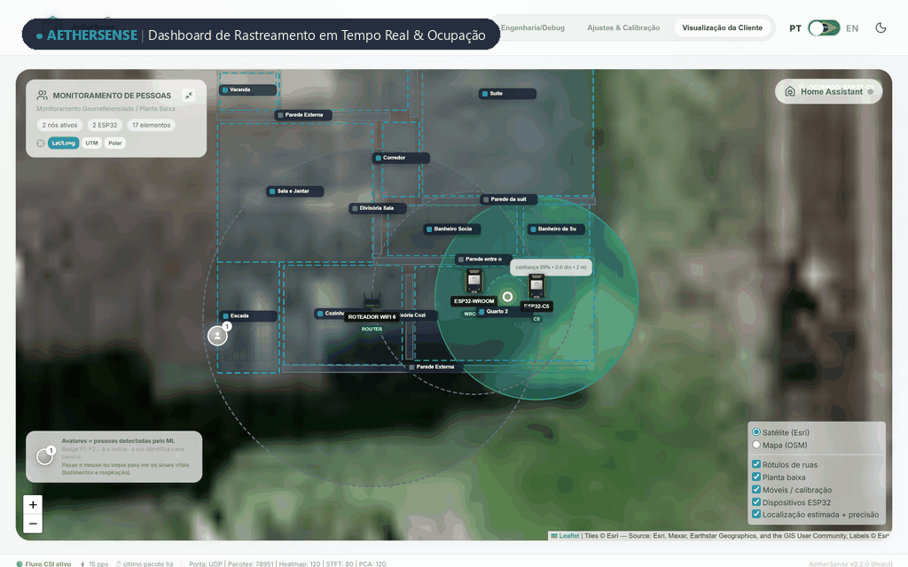
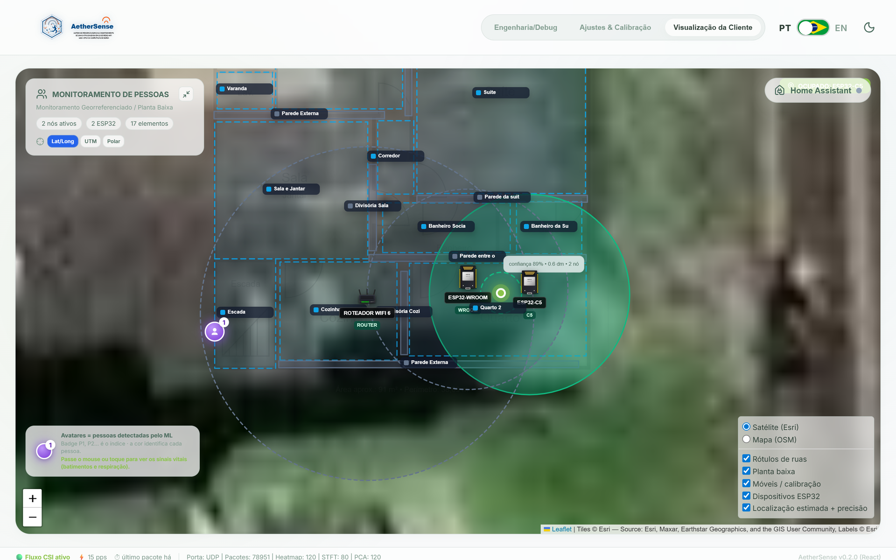
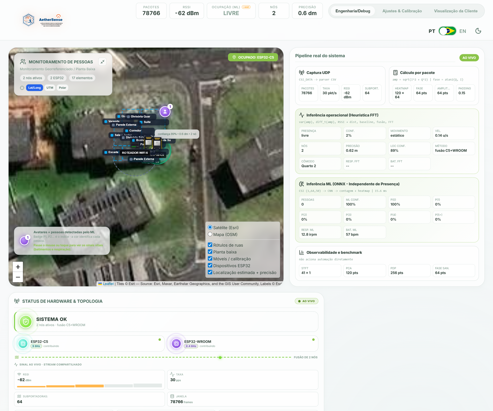
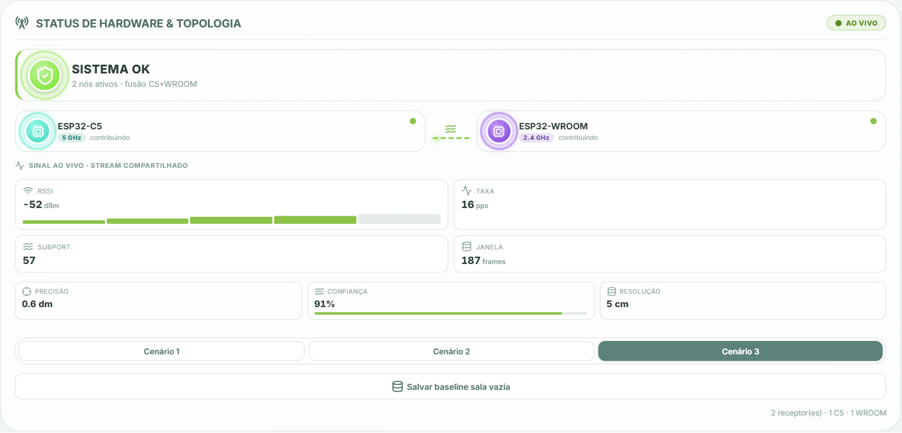
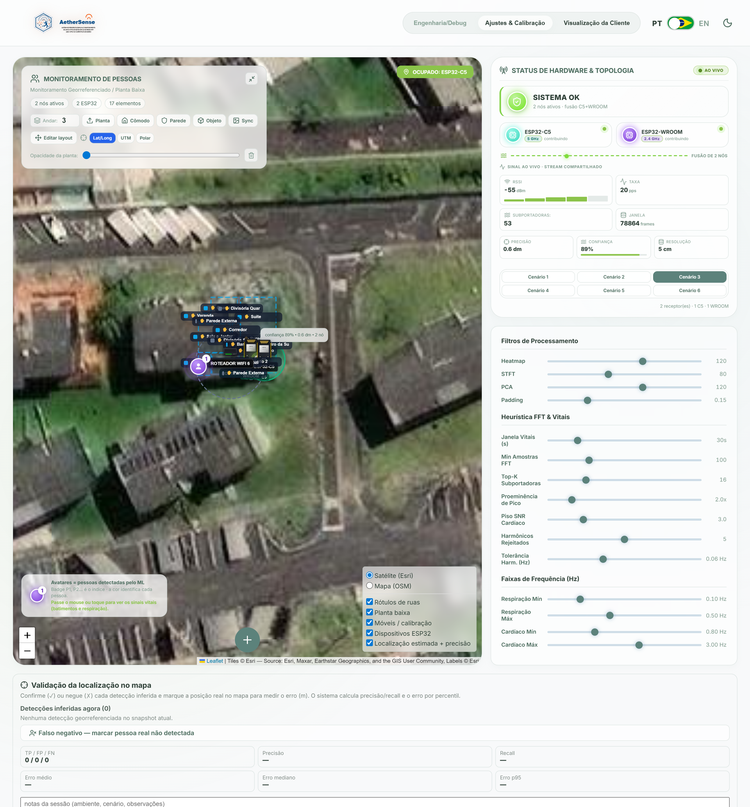
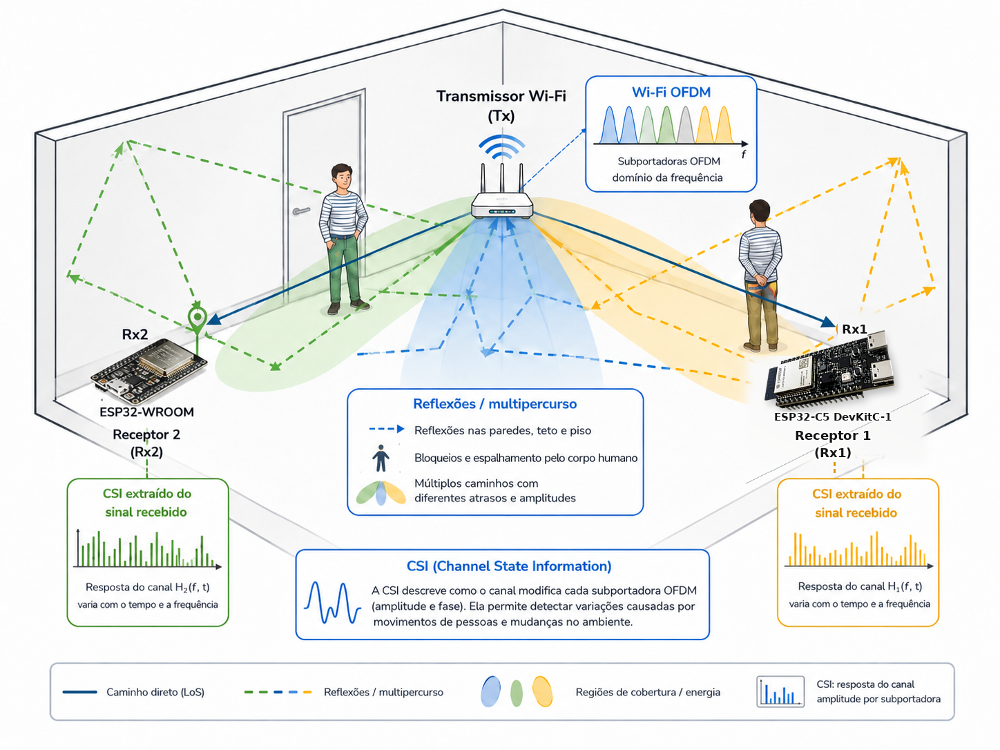

<p align="center">
  
</p>

# AetherSense

AetherSense é uma plataforma experimental de sensoriamento por Wi‑Fi baseada
em *Channel State Information* (CSI). O projeto reúne firmware para ESP32,
backend em Rust, dashboard web, inferência ONNX e integração com Home
Assistant.

> O sistema é um protótipo de pesquisa. Localização e sinais vitais são
> experimentais e não devem ser usados para diagnóstico, segurança ou decisões
> críticas.

<p align="center">
  
</p>

## Demonstração do Sistema em Operação

### 1. Visão Geral e Rastreamento em Tempo Real

O modo operacional (*Dashboard Cliente*) apresenta a planta baixa interativa com a localização estimada em tempo real, mapa de calor de presença, contagem de ocupação e zonas delimitadas (ex.: box de chuveiro, áreas ativas):

<p align="center">
  
</p>

- **Rastreamento espacial**: cálculo contínuo de coordenadas \((x, y)\) com filtro EWMA;
- **Detecção de ocupação**: contagem de pessoas via classificação ONNX e heurísticas estatísticas;
- **Zonas configuráveis**: definição de polígonos e gatilhos de automação residencial.

### 2. Processamento Digital de Sinais (DSP) & Diagnóstico de RF

O modo de engenharia (*Dashboard Debug*) expõe o pipeline analítico de radiofrequência em tempo real, permitindo inspecionar o comportamento físico do canal sem fio:

<p align="center">
  
</p>

- **Heatmap de Subportadoras**: matriz tempo \(\times\) subportadora da atenuação de amplitude;
- **Espectrograma STFT Doppler**: detecção de velocidade e discriminação de micro-movimentos dinâmicos;
- **Desenrolamento de Fase**: sanitização de erro residual de sincronismo de fase e amostragem;
- **Perfil de Atraso de Potência (PDP)**: estimativa do espalhamento temporal por multitrajeto via IFFT.

### 3. Topologia de Hardware & Calibração

O sistema monitora dinamicamente a malha de dispositivos receptores e permite calibração de ruído estático sem necessidade de coleta de dados humanos locais:

<p align="center">
  
</p>

<p align="center">
  
</p>

- **Telemetria de nós**: monitoramento em tempo real de taxa de amostragem (\(\sim 10\text{ Hz}\)), RSSI e latência por nó receptor (ESP32-WROOM-32 e ESP32-C5);
- **Calibração de Sala Vazia (*Empty Room*)**: subtração de fundo para isolar variações do ambiente e mitigar efeitos de mobília e reflexões estáticas.

### 4. Fundamentos Físicos & Extração de CSI

O sensoriamento passivo do AetherSense utiliza a estrutura multiportadora do padrão IEEE 802.11 (OFDM). Cada quadro recebido carrega uma matriz de resposta em frequência do canal, sensível às perturbações causadas pelo corpo humano:

<p align="center">
  
</p>

---

## Componentes

| Diretório | Conteúdo |
| --- | --- |
| `firmware-rust/` | Firmware ativo para ESP32-WROOM-32 e ESP32-C5 |
| `aethersense-server/` | API, ingestão UDP, processamento CSI e inferência |
| `frontend/` | Dashboard React + TypeScript |
| `ml/` | Treinamento, avaliação e exportação ONNX |
| `homeassistant/` | Pacote e add-on para Home Assistant |
| `esp_realtime_plot/` | Ferramentas Python para inspeção de CSI |
| `docs/` | Arquitetura e guias avançados |

## Requisitos

- Docker com Docker Compose, para executar backend, frontend e MQTT;
- Git;
- para desenvolver o firmware: Rust, ESP-IDF e `uv`;
- uma placa compatível e uma rede Wi‑Fi, caso queira receber CSI real.

O dashboard e o modo de reprodução podem ser explorados sem gravar firmware.

## Início rápido

Clone o projeto:

```bash
git clone https://github.com/joaosnet/aethersense.git
cd aethersense
```

Crie a configuração local:

```bash
cp aethersense-server/aethersense_config.example.json \
   aethersense-server/aethersense_config.json
```

No PowerShell:

```powershell
Copy-Item aethersense-server/aethersense_config.example.json `
  aethersense-server/aethersense_config.json
```

Suba os serviços:

```bash
docker compose up --build
```

Acesse:

- dashboard: <http://localhost>;
- API: <http://localhost:8000>;
- saúde da API: <http://localhost:8000/api/health>;
- entrada CSI: UDP `5005` no Linux ou o relay documentado para Docker Desktop.

Credenciais devem ser fornecidas somente por variáveis de ambiente:

```bash
export AETHERSENSE_API_TOKEN="troque-este-valor"
export AETHERSENSE_MQTT_USERNAME="usuario"
export AETHERSENSE_MQTT_PASSWORD="senha"
docker compose up --build
```

Não coloque credenciais em arquivos versionados.

## Firmware

O fluxo ativo está em `firmware-rust/`. Use sempre o script de build:

```bash
cd firmware-rust
uv run build.py build
uv run build.py flash --port SUA_PORTA
uv run build.py run --port SUA_PORTA
```

No primeiro boot, credenciais Wi‑Fi podem ser configuradas pelo portal cativo.
Consulte [FLASHING.md](firmware-rust/FLASHING.md) para os perfis de hardware,
recuperação e solução de problemas.

## Desenvolvimento

Backend:

```bash
cd aethersense-server
cargo test --locked --lib
cargo run
```

Os ensaios de integração `M1`–`M7` dependem de hardware ou de capturas
fornecidas pelo próprio usuário. Capturas da instalação original não são
publicadas.

Frontend:

```bash
cd frontend
npm ci
npm run dev
```

Pipeline de aprendizado de máquina:

```bash
cd ml
uv sync
uv run main.py --help
```

Datasets e artefatos de treinamento não são armazenados no repositório. Os
scripts de `ml/` fazem o download das fontes públicas e exportam os modelos.

## Documentação

- [Visão da arquitetura](docs/arquitetura-firmware-servidor.md)
- [Firmware e gravação](firmware-rust/README.md)
- [Backend](aethersense-server/README.md)
- [Frontend](frontend/README.md)
- [Pipeline de ML](ml/README.md)
- [Integração com Home Assistant](docs/home-assistant-integration.md)
- [Mapa da documentação](docs/README.md)
- [Política de segurança](SECURITY.md)

## Privacidade e dados

O repositório público não contém credenciais, configurações residenciais,
coordenadas, identificadores de dispositivos nem capturas locais. Arquivos
gerados em execução permanecem ignorados pelo Git. Ao compartilhar resultados,
anonimize MACs, endereços, nomes de redes, coordenadas e dados de pessoas.

## Estado do projeto

O pipeline de aquisição, processamento, visualização, treinamento e integração
está implementado. A validade física das estimativas depende do ambiente, da
topologia e da calibração. Resultados de bases públicas não garantem
generalização para uma instalação diferente.

Contribuições são bem-vindas por *issues* e *pull requests*. Ao relatar falhas
de segurança, siga [SECURITY.md](SECURITY.md) e não publique segredos em uma
*issue*.
