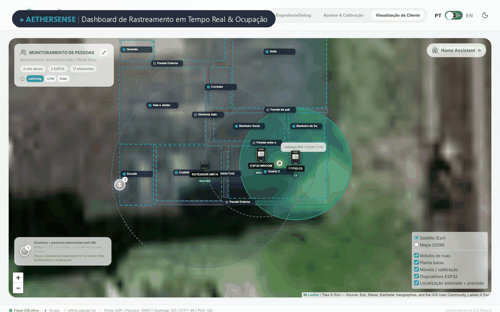
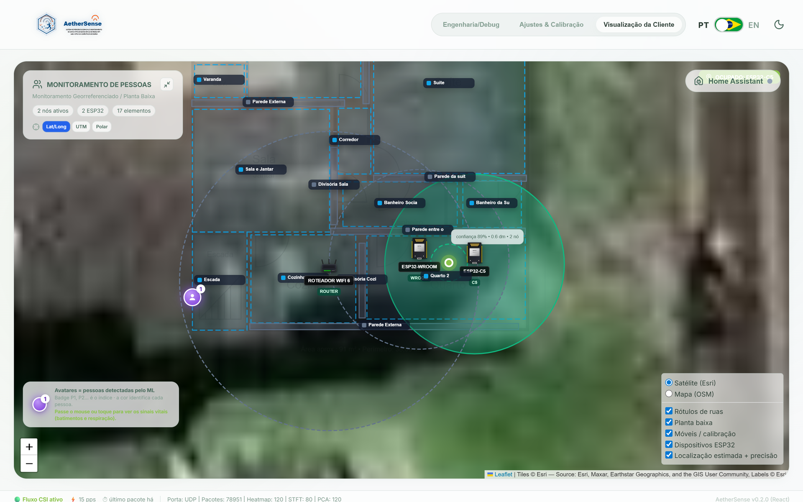
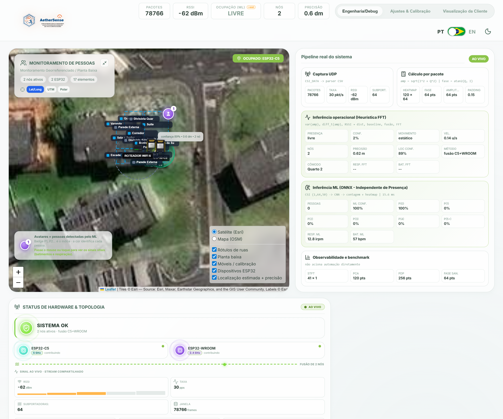
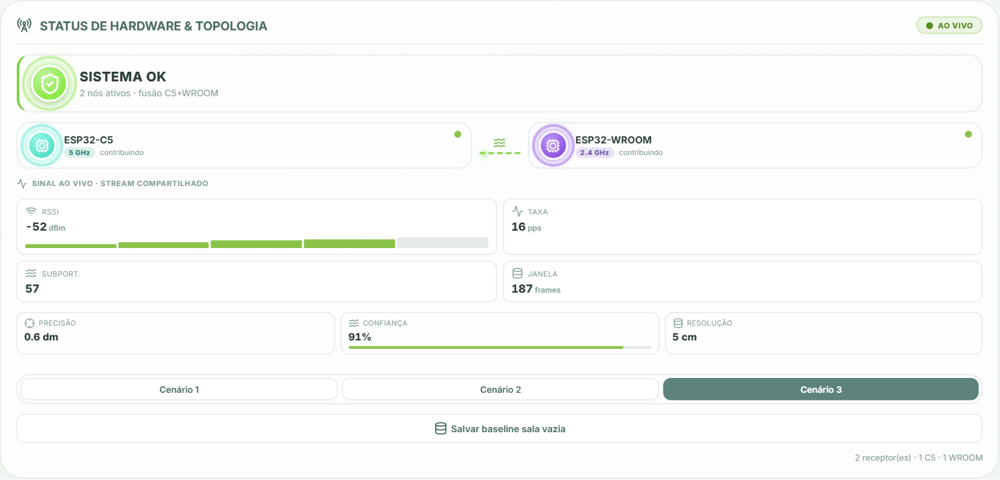
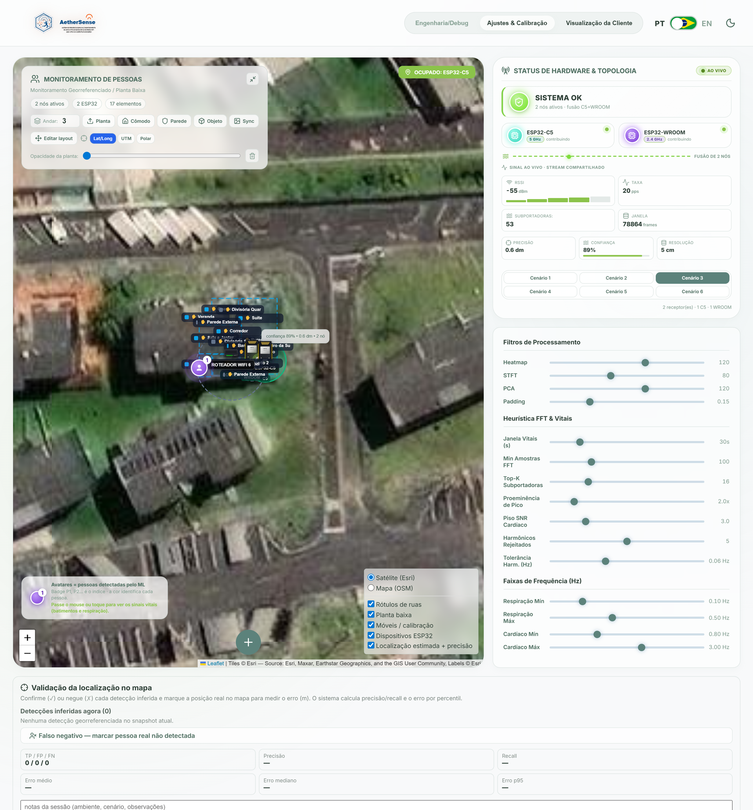
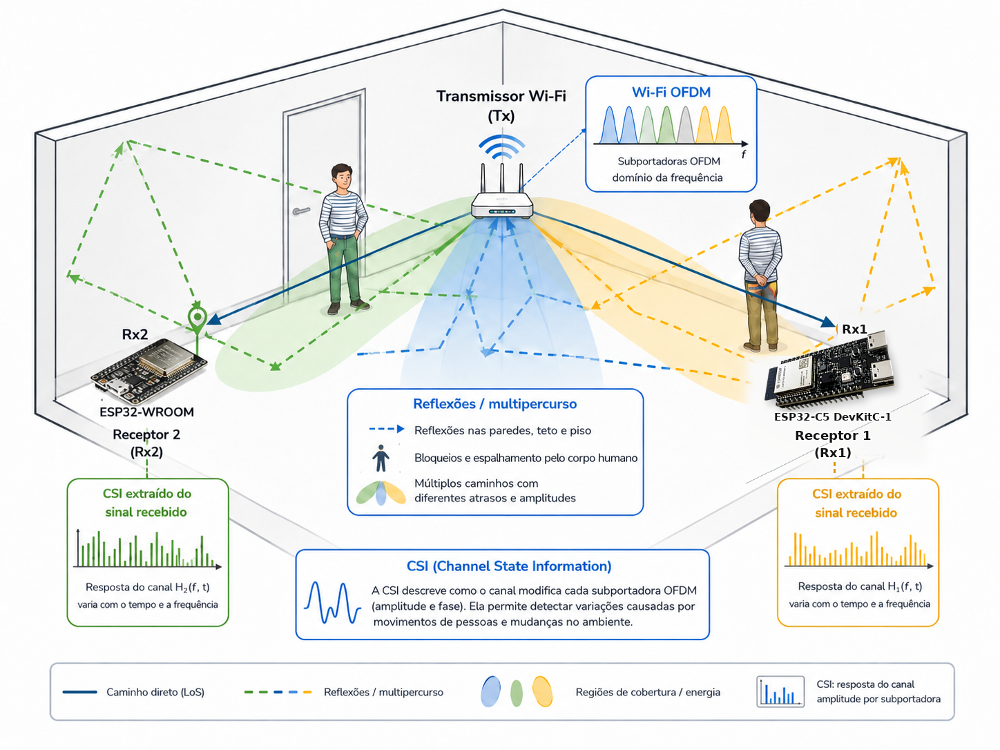

<p align="center">
  
</p>

<p align="center">
  <a href="README.md">English (USD $)</a> ·
  <strong>Português (BR · BRL R$)</strong> ·
  <a href="README.es.md">Español (EUR € / USD $)</a> ·
  <a href="README.de.md">Deutsch (EUR €)</a>
</p>

# AetherSense

O **AetherSense** é uma plataforma aberta de sensoriamento espacial e automação residencial baseada em **Wi-Fi Channel State Information (CSI)** — **sem câmeras e 100% local**. Reunindo nós ESP32 de baixo custo, servidor em Rust de alta performance, dashboard web, inferência ONNX opcional e integração com Home Assistant, o projeto entrega **presença geolocalizada por cômodo/zona, intensidade de movimento, tendências experimentais de sinais vitais e automação local por infravermelho (IR) e relés** usando o Wi-Fi que você já tem em casa.

> **Transparência Científica:** O AetherSense nasceu como protótipo de pesquisa de TCC para sensoriamento espacial e automação residencial local sem câmeras. Estimativas de localização e sinais vitais são experimentais e não devem ser usadas para diagnóstico médico, segurança patrimonial crítica ou decisões de risco de vida.

<p align="center">
  
</p>

---

## Por que AetherSense? Comparativo de Custo & Eficiência (BRL `R$`)

> Preços estimados com base em faixas atuais de mercado no **Mercado Livre**, **Amazon Brasil** e **AliExpress** (sujeitos a frete e impostos de importação como Remessa Conforme). Os valores do AetherSense DIY refletem o custo dos componentes eletrônicos antes de gabinete, montagem e garantia.

| Solução | Tecnologia | Preço Est. (BRL) | Presença Estática (Parado/Dormindo) | Multi-Cômodo / Atravessa Paredes | Controle IR / Relé Integrado | Privacidade (Sem Câmera) | 100% Local (Sem Nuvem) | Links de Referência e Compra |
| :--- | :--- | :---: | :---: | :---: | :---: | :---: | :---: | :--- |
| **AetherSense (1 Nó Wi-Fi CSI)** *(BOM DIY)* | Wi-Fi CSI (`ESP32-WROOM-32` / `ESP32-C5`) | **R$ 30–95** | Sim (CSCR + baseline) | Parcial (1 cômodo/link) | Sim (IR 38 kHz + Relé) | Sim | Sim | [Espressif ESP32-C5](https://www.espressif.com/en/products/socs/esp32-c5) · [Mercado Livre](https://lista.mercadolivre.com.br/esp32-wroom-32) · [AliExpress](https://www.aliexpress.com/w/wholesale-esp32-wroom-32.html) |
| **AetherSense (Kit Multi-Nó)** *(BOM DIY)* | Wi-Fi CSI Dual-Band (`C5` 5 GHz + `WROOM` 2,4 GHz) | **R$ 130–200** | Sim | **Sim** (fusão por zonas) | Sim (por nó) | Sim | Sim | [Releases](https://github.com/joaosnet/aethersense/releases) · [AliExpress C5](https://www.aliexpress.com/w/wholesale-esp32-c5.html) |
| **RuView (WiFi DensePose)** | Wi-Fi CSI (`3–6× ESP32-S3` Mesh) | **~R$ 300+** *(importação)* | Sim | Sim (mesh) | Não | Sim | Sim | [GitHub (ruvnet/RuView)](https://github.com/ruvnet/RuView) · [AliExpress ESP32-S3](https://www.aliexpress.com/w/wholesale-esp32-s3.html) |
| **Sensor Presença Tuya mmWave (`ZY-M100`)** | Radar mmWave 5,8 / 24 GHz | **R$ 110–250** | **Sim** | Não (visada direta / 1 cômodo) | Não | Sim | Zigbee: Sim · Wi-Fi: Nuvem Tuya | [Blakadder](https://blakadder.com/) · [Zigbee2MQTT](https://www.zigbee2mqtt.io/) · [Mercado Livre](https://lista.mercadolivre.com.br/sensor-presenca-humana-tuya-mmwave) · [AliExpress](https://www.aliexpress.com/w/wholesale-tuya-zy-m100-mmwave.html) |
| **Aqara Presence Sensor FP2** | Radar mmWave 60 GHz Multi-Zona | **R$ 440–550** | **Sim** (até 30 zonas / 5 pessoas) | Não (1 cômodo por sensor) | Não | Sim | Sim (HomeKit / HA) | [Aqara Oficial](https://www.aqara.com/en/product/presence-sensor-fp2/) · [Mercado Livre](https://lista.mercadolivre.com.br/aqara-fp2) |
| **Sensor Movimento PIR Wi-Fi Comum** | Infravermelho Passivo (PIR) | **R$ 25–130** | **Não** (só detecta movimento amplo) | Não (cone óptico livre) | Não | Sim | Geralmente Nuvem | [Mercado Livre](https://lista.mercadolivre.com.br/sensor-movimento-wifi-pir) |
| **Câmera Wi-Fi Interna (`Tapo C200`)** | Vídeo Óptico + IA | **R$ 200–300** | Sim (visão) | Não (precisa de luz/visada) | Não | **Não** (grava vídeo/áudio) | Parcial (RTSP / SD) | [TP-Link Oficial](https://www.tp-link.com/en/home-networking/cloud-camera/tapo-c200/) · [Mercado Livre](https://lista.mercadolivre.com.br/tapo-c200) |

> Configurações com 1 nó atendem presença por cômodo/zona e movimento; kits multi-nó dual-band ampliam a fusão entre ambientes e o rastreamento espacial.

---

## Onde Comprar ou Montar (BRL `R$`)

### Opção A — Kit AetherSense Pronto para Uso *(Em Breve)*
- **Kit Plug-and-Play AetherSense**: *Kits pré-gravados com gabinete protetor, fonte 5V e configuração local guiada — em preparação.* Acompanhe as atualizações em [GitHub Releases](https://github.com/joaosnet/aethersense/releases) e [Discussions](https://github.com/joaosnet/aethersense/discussions).

### Opção B — Lista de Peças DIY (Monte Você Mesmo)
- **Nó Principal 5 GHz Wi-Fi 6 (`ESP32-C5-DevKitC-1`)**: ~**R$ 90–130** (importado) — [Espressif](https://www.espressif.com/en/products/socs/esp32-c5) · [AliExpress](https://www.aliexpress.com/w/wholesale-esp32-c5-devkit.html)
- **Nó Secundário 2,4 GHz (`ESP32-WROOM-32`)**: ~**R$ 35–60** (Mercado Livre) / ~**R$ 15–30** (AliExpress) — [Mercado Livre](https://lista.mercadolivre.com.br/esp32-wroom-32) · [AliExpress](https://www.aliexpress.com/w/wholesale-esp32-wroom-32.html)
- **Módulo IR Emissor/Receptor 38 kHz** *(Opcional)*: ~**R$ 15–25** — [Mercado Livre](https://lista.mercadolivre.com.br/modulo-emissor-receptor-ir-esp32)
- **Fonte USB-C 5V ≥ 1A + Cabo**: ~**R$ 20–35** (evita quedas de Wi-Fi por queda de tensão)

---

## Demonstração do Sistema em Operação

### 1. Visão Operacional (Dashboard Cliente)
Planta baixa interativa com localização estimada em tempo real, mapa de calor de presença, contagem de ocupação e zonas delimitadas para automação:

<p align="center">
  
</p>

- **Rastreamento espacial**: cálculo contínuo com filtro EWMA e fusão multi-nó por zona;
- **Automação residencial**: gatilhos locais e integração automática com Home Assistant via MQTT Discovery;
- **Acessórios integrados**: aprendizado e disparo IR (ar-condicionado/TV) e controle de relés por nó.

### 2. Processamento Digital de Sinais (DSP) & Diagnóstico de RF
O modo de engenharia (*Dashboard Debug*) expõe o pipeline analítico em tempo real:

<p align="center">
  
</p>

- **Heatmap de Subportadoras** · **Espectrograma STFT Doppler** · **Sanitização de Fase** · **Perfil de Atraso de Potência (PDP) via IFFT**.

### 3. Topologia de Hardware & Calibração de Sala Vazia
Monitoramento em tempo real de taxa de amostragem, RSSI e banda por nó, com calibração estática sem coleta de dados humanos locais:

<p align="center">
  
</p>

<p align="center">
  
</p>

### 4. Fundamentos Físicos & Extração de CSI
O sensoriamento passivo utiliza a estrutura multiportadora OFDM do padrão IEEE 802.11 para detectar perturbações causadas pelo corpo humano no canal sem fio:

<p align="center">
  
</p>

---

## Componentes

| Diretório | Conteúdo |
| :--- | :--- |
| `firmware-rust/` | Firmware ativo para ESP32-WROOM-32, ESP32-C5 e ESP32-C6 |
| `aethersense-server/` | Servidor Rust: API, ingestão UDP, processamento CSI, ONNX e MQTT |
| `frontend/` | Dashboard web React + TypeScript |
| `ml/` | Pipeline de treinamento, avaliação e exportação ONNX (apenas datasets públicos) |
| `homeassistant/` | Pacote e add-on para Home Assistant |
| `esp_realtime_plot/` | Ferramentas Python para inspeção serial em tempo real |
| `docs/` | Arquitetura e guias avançados |

---

## Início Rápido

Clone o repositório e crie o arquivo de configuração local:

```bash
git clone https://github.com/joaosnet/aethersense.git
cd aethersense
cp aethersense-server/aethersense_config.example.json aethersense-server/aethersense_config.json
```

Suba os serviços passando credenciais apenas por variáveis de ambiente:

```bash
export AETHERSENSE_API_TOKEN="troque-este-valor"
export AETHERSENSE_MQTT_USERNAME="usuario"
export AETHERSENSE_MQTT_PASSWORD="senha"
docker compose up --build
```

- Dashboard: <http://localhost>
- Saúde da API: <http://localhost:8000/api/health>
- Ingestão CSI: `5005/udp` · Descoberta do broker: `5151/udp`

### Gravação do Firmware (Fluxo Dev)
```bash
cd firmware-rust
uv run build.py build
uv run build.py flash --port SUA_PORTA
```
Consulte [firmware-rust/FLASHING.md](firmware-rust/FLASHING.md) para perfis de placa, portal cativo e recuperação.

---

## Documentação, Privacidade & Segurança

- [Mapa da Documentação](docs/README.md) · [Arquitetura](docs/arquitetura-firmware-servidor.md) · [Home Assistant](docs/home-assistant-integration.md)
- [Backend](aethersense-server/README.md) · [Frontend](frontend/README.md) · [Pipeline de ML](ml/README.md)
- [Política de Segurança](SECURITY.md)

O repositório público não contém credenciais, endereços residenciais, identificadores de dispositivos nem capturas locais. Para relatar vulnerabilidades, siga [SECURITY.md](SECURITY.md).
