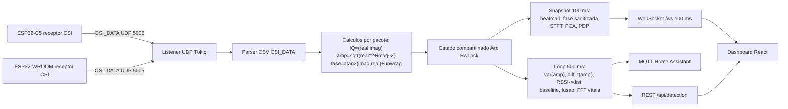
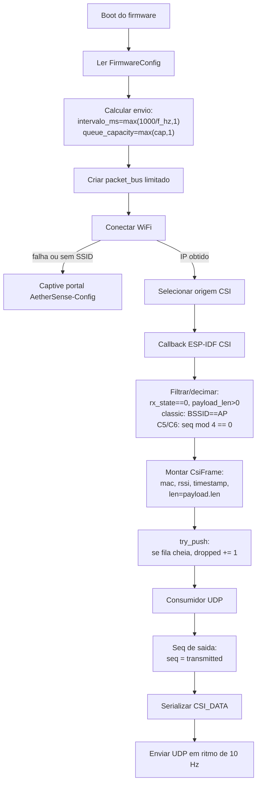
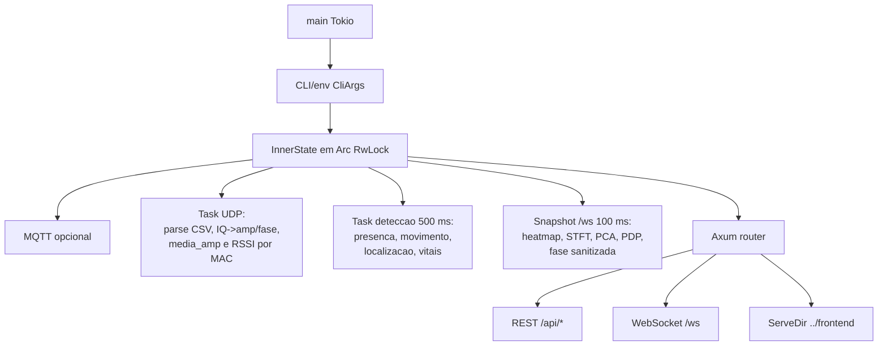
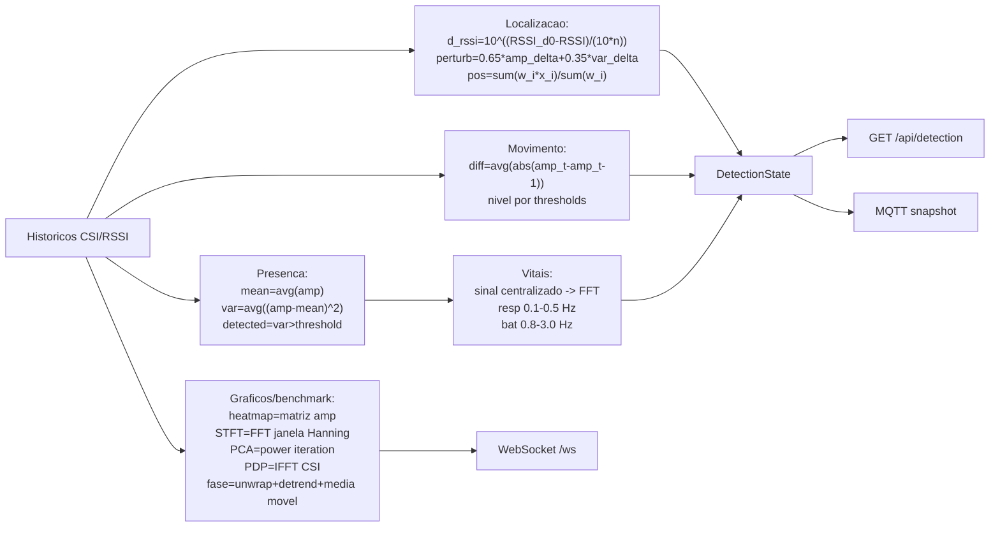

# Arquitetura Interna do Firmware Rust e do Servidor Web

Este documento detalha como o AetherSense funciona por dentro no fluxo ativo de maio de 2026: dois ESP32 receptores CSI executando `firmware-rust/`, um servidor Rust em `aethersense-server/` recebendo UDP e publicando REST, WebSocket e MQTT, e o frontend React consumindo o estado em tempo real.

> **Atualização 2026-06-12**: o servidor ganhou três camadas novas, descritas
> em documentos dedicados — inferência ONNX (`src/ml/`, ver
> `ml-pipeline-status.md`), zonas de ocupação adaptativas por receptor
> (`src/detection/zones.rs`) e a integração de automações com o Home
> Assistant (ver `automacao-zonas-home-assistant.md`). O firmware passou a
> enviar em **broadcast** (imune a mudança de IP do PC) e o deploy é 100%
> Docker (`docker-compose.yml` + relay no Windows ou
> `docker-compose.linux.yml` com host network).

## Fluxo ponta a ponta



O firmware nao faz inferencia. Ele conecta no WiFi, habilita a captura CSI do ESP-IDF, converte o callback bruto em linhas `CSI_DATA` e envia os pacotes por UDP. O servidor e o ponto de decisao: ele parseia os pacotes, atualiza historicos por MAC, executa as heuristicas de presenca, movimento, localizacao e vitais, e entrega o estado para dashboard e automacao.

## Firmware Rust

O ponto de entrada em `firmware-rust/src/main.rs` monta a aplicacao embarcada em etapas pequenas:

1. Inicializa os patches e logs do ESP-IDF quando roda no alvo real.
2. Aplica um atraso inicial para permitir recuperacao por `espflash` em caso de loop de panic.
3. Le `FirmwareConfig::from_env()`, incluindo `AETHERSENSE_HARDWARE_PROFILE`, `AETHERSENSE_UDP_HOST`, `AETHERSENSE_UDP_PORT`, `AETHERSENSE_SEND_FREQUENCY_HZ`, `AETHERSENSE_QUEUE_CAPACITY`, banda WiFi e preferencia HT40.
4. Cria o `packet_bus`, uma fila limitada que desacopla o callback CSI da transmissao UDP.
5. Conecta o WiFi, resolve o destino UDP e instala a origem CSI adequada ao perfil da placa.
6. Cria o `UdpTransmitter` e inicia a thread consumidora que serializa `CsiFrame` em `CSI_DATA`.



### Captura CSI

`source.rs` escolhe a origem real do ESP-IDF. No alvo embarcado, `connect_wifi()` primeiro estabelece a rede e so depois a captura CSI e instalada. Isso evita a falha historica de abrir socket ou callback antes do IP estar pronto.

`ffi.rs` concentra a ponte com o ESP-IDF:

- `CaptureProfile::from_hardware_profile()` escolhe `classic`, `esp32c5` ou `esp32c6`.
- `CsiCaptureConfig` traduz o perfil para os campos esperados pelo driver.
- O filtro promiscuo aceita pacotes `DATA` e `MGMT`, reduzindo ruido de ACK/controle.
- O callback descarta frames invalidos, filtra BSSID no perfil classic, aplica decimacao em C5/C6 e converte bytes CSI em `Vec<i16>`.
- O MAC publicado no frame e o MAC estavel da estacao, nao o BSSID do roteador.

### Transporte UDP

`runtime.rs` cria uma fila sincronizada de capacidade configuravel, hoje 256. Quando a fila enche, o callback nao bloqueia: ele incrementa o contador de descartes e retorna. A thread UDP consome a fila, atribui `seq` apenas para pacotes efetivamente transmitidos, serializa a linha CSV pelo contrato `CSI_DATA` e respeita o intervalo derivado de `AETHERSENSE_SEND_FREQUENCY_HZ`.

O contrato emitido por `csi.rs` e:

```text
CSI_DATA,seq,mac,rssi,rate,sig_mode,mcs,cwb,smoothing,not_sounding,aggregation,stbc,fec_coding,sgi,noise_floor,ampdu_cnt,channel,secondary_channel,timestamp,ant,sig_len,rx_state,len,first_word_invalid,"[payload]"
```

Esse formato e preservado para compatibilidade com o parser do servidor e com os testes de ingestao live.

### Resiliencia de conexao (monitor de saude)

`health.rs` resolve o sintoma historico de "o ESP some da rede ate o power-cycle": antes nao havia reconexao pos-boot, entao qualquer queda transitoria de WiFi deixava o dispositivo morto. Uma thread de monitor (gated em `esp-idf`, criada em `main.rs` junto ao consumidor UDP) verifica a saude a cada `AETHERSENSE_HEALTH_CHECK_SECS` (5 s) em duas camadas:

- **L2 (associacao):** `esp_wifi_sta_get_ap_info`. Se a STA caiu, chama `esp_wifi_connect()` para reassociar.
- **L3 (IP/DHCP):** `esp_netif_get_ip_info` no netif `WIFI_STA_DEF`. Se esta associada mas sem IP por uma carencia (contada desde a reassociacao, com throttle), forca `esp_wifi_disconnect()` + `esp_wifi_connect()` para re-disparar o DHCP. Se o netif nao for encontrado, degrada para checar so L2 (nao penaliza).

Dois backstops independentes de `esp_restart()`: insalubre (sem L2 ou L3) por `AETHERSENSE_REBOOT_AFTER_SECS` (300 s); ou saudavel mas sem envio UDP por `AETHERSENSE_STALL_REBOOT_SECS` (180 s) — este ultimo cobre a thread de trafego morta / CSI travado, usando um heartbeat (`last_send_secs`, `AtomicU32` em segundos, pois os alvos ESP nao tem `AtomicU64`) atualizado a cada envio. O `captive_portal.rs` ganhou um watchdog: quando ha credenciais reais na NVS mas a AP esta indisponivel, o portal reabre com timeout (rearmado por atividade do usuario) e o device re-tenta a rede salva sozinho, em vez de ficar preso no AP de config. O guia de uso esta em `firmware-rust/FLASHING.md`.

## Servidor Web Rust

O servidor inicia em `aethersense-server/src/main.rs`. Ele cria o estado compartilhado, inicia MQTT quando configurado, cria uma task Tokio para UDP, outra para deteccao periodica e por fim serve Axum.



### Ingestao UDP e estado

`udp.rs` escuta `0.0.0.0:5005` com socket UDP reutilizavel. Cada datagrama e convertido para texto UTF-8, passa por `parse_csi_packet()` e, quando valido, entra em `InnerState::push_packet()`.

O parser usa o crate `csv` para respeitar o payload entre aspas, extrai os campos do cabecalho, converte o payload para amostras numericas e monta pares IQ como `Complex { re, im }`. A amplitude de cada subportadora e `sqrt(real^2 + imag^2)`, e a fase vem de `atan2(imag, real)` com unwrap simples.

O estado mantem dois niveis de historico:

- historico global, usado pelo dashboard e pelas deteccoes gerais;
- `device_histories` por MAC, usado por localizacao, baseline e perda por dispositivo.

Quando um MAC novo aparece, o servidor cria um `DeviceInfo` automaticamente como receptor, inferindo `esp32c5` para MACs iniciados por `d0:cf` e `wroom` para os demais.

### Loop de deteccao

A cada 500 ms, `detection_loop()` tira uma fotografia do estado e atualiza:

- `presence`: variancia recente da amplitude media;
- `movement`: diferenca media entre vetores de amplitude consecutivos;
- `location`: RSSI, amplitude media, variancia, baseline de sala vazia e fusao C5 + WROOM;
- `vitals`: FFT experimental sobre a serie temporal quando ha presenca.



### Inferencia por ML (ONNX)

Em paralelo a heuristica, o mesmo `detection_loop()` executa uma inferencia por aprendizado de maquina via `ml_engine.infer(...)` (modulo `aethersense-server/src/ml/`, biblioteca `tract-onnx` — Rust puro, sem Python/GPU em producao, ~2–10 ms/quadro em CPU):

- **`occupancy.onnx`** (CNN/U-Net): entrada `(1, 1, 64, 50)` (1 antena, 64 subportadoras reamostradas, 50 amostras) -> `count_logits (1,6)` + `heatmap (1,1,20,20)`. Os picos do heatmap (NMS 5x5) viram pessoas com `lat/lng` (`ml/decode.rs`). O receptor e escolhido por `pick_history` (preferencia pelo ESP32-C5).
- **`vitals.onnx`** (VitalsNet/LSTM): regride respiracao e batimentos globais.

O resultado vai para `inner.detection.occupancy` e a comparacao ML x heuristica e exposta em `GET /api/ml/status`. A ocupacao binaria publicada ao HA (`aethersense_occupancy`) e **confirmada pela zona** (`confirm_occupancy` em `mqtt.rs`): tanto a variancia quanto o ML dao falso positivo em sala vazia — o ML por lacuna de dominio (treino em datasets publicos x ambiente local), observado no ensaio do Cenario 2.

> Modelos treinados offline em GPU (Thunder Compute) com datasets publicos. Ver `docs/ml-pipeline-status.md` e `docs/avaliacao-cenario-2.md`.

### API, WebSocket e persistencia

Rotas REST principais:

| Rota | Uso |
| --- | --- |
| `GET /api/health` | Healthcheck simples. |
| `GET/POST /api/settings` | Janelas de heatmap, STFT, PCA e padding do dashboard. |
| `POST /api/clear` | Limpa historicos em memoria. |
| `GET/POST /api/devices` | Lista, cadastra e edita receptores/roteadores no mapa. |
| `POST /api/location/baseline` | Salva baseline de sala vazia por receptor ativo. |
| `GET /api/detection` | Retorna presenca, movimento, localizacao e vitais. |
| `GET /ws` | Envia snapshot completo a cada 100 ms para o dashboard. |

`aethersense_config.json` persiste `settings`, `devices` e `location_baselines`. Assim, o mapa e a calibracao de sala vazia sobrevivem a reinicios do container ou do servidor.

## Auditoria dos calculos

A verificacao de uso no codigo separou os calculos em tres classes.

| Calculo | Onde aparece | Papel real |
| --- | --- | --- |
| Amplitude por IQ | Parser, historicos, deteccoes, dashboard | Base operacional do sistema. |
| Media/variancia de amplitude | Presenca, movimento, localizacao, baseline, benchmark | Inferencia e validacao. |
| Media RSSI e modelo log-distance | Localizacao | Inferencia operacional. |
| Fusao C5 + WROOM | Localizacao | Inferencia operacional. |
| FFT de vitais | `detection_loop` quando ha presenca | Inferencia experimental, nao clinica. |
| Heatmap | WebSocket/dashboard e M2 | Observabilidade visual. |
| Fase sanitizada por subportadora | WebSocket/dashboard, M2 e M6 | Observabilidade e benchmark de estabilidade; nao aciona automacao live. |
| STFT | WebSocket/dashboard, M2 e M6 dynamic range | Observabilidade e benchmark; nao entra no `DetectionState` live. |
| PCA | WebSocket/dashboard, M2 e M6 PC1 | Observabilidade e benchmark; nao entra no `DetectionState` live. |
| PDP | WebSocket/dashboard e M2 | Observabilidade de multicaminho; nao entra no `DetectionState` live. |
| `smooth_signal_series` | STFT do snapshot e M6 SNR/CV | Pre-processamento de visualizacao/benchmark. |

Conclusao da auditoria: nao ha calculo morto, sem consumidor. Existem, porem, calculos cujo consumidor principal e grafico, teste de sanidade ou benchmark academico. Eles devem ser apresentados como observabilidade/validacao, nao como parte da decisao operacional de presenca, movimento, localizacao ou automacao.

## Implicacao para a escrita academica

Ao descrever o sistema, a afirmacao correta e:

- o pipeline operacional live e formado por amplitude/RSSI/historicos, presenca, movimento, localizacao fusionada e vitais experimentais;
- STFT, PCA, PDP, heatmap e fase sanitizada sao ferramentas de analise e acompanhamento do sinal, uteis para depuracao, visualizacao e benchmark M2/M6;
- vitais permanecem experimentais e nao devem ser apresentados como medicao clinica;
- a calibracao local permitida e apenas de sala vazia, sem coleta humana local supervisionada.
